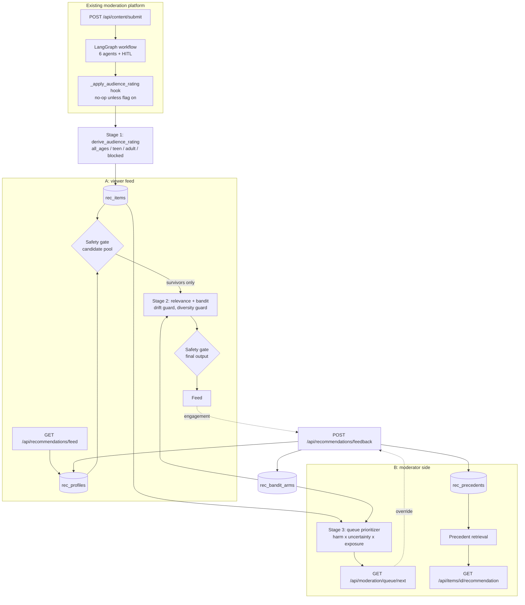

# 01 - Design

Age-Gated Profile Recommender with Uncertainty-Aware Safety Margins.
Two purposes: (A) an age-aware recommendation feed for viewers, (B) a review-queue
prioritizer for moderators.

## What this is, honestly

A composition of well-known techniques, arranged so that the safety decision is
deterministic and sits outside everything that learns. It is not a new algorithm.

| Part | Builds on |
|---|---|
| Audience rating | Rule-based content rating (film/game rating boards), fail-closed defaults |
| Safety gate | Allow-list filtering, defence in depth, hard constraints applied after ranking |
| Uncertainty margin | Ensemble disagreement as an uncertainty signal; selective prediction / abstention |
| Relevance | TF-IDF vectors and cosine similarity (content-based filtering) |
| Explore/exploit | Thompson sampling with Beta-Bernoulli arms |
| Drift guard | Exposure caps and trend penalties from the filter-bubble / radicalization-pathway literature |
| Diversity guard | Slot reservation for out-of-profile items (diversified re-ranking) |
| Queue priority | Risk x uncertainty x exposure triage, as in content-moderation and incident queues |
| Precedents | Case-based reasoning / nearest-neighbour retrieval for explainability |
| Feedback | Human-in-the-loop corrections as a bandit reward |

What is specific to this project is the wiring: the learned parts only ever see items the
gate has already admitted, and their output is gated again.

## Data flow

The two gate boxes are the same code. Nothing between them can add an item: the ranker
receives survivors and returns a subset. If a ranker did add or alter an item, the second
gate removes it (`tests/test_rec_feed_service.py`).

## Stage 1 - rating and gate

Described in full in `02_safety_policy.md`. In brief: the rating starts at `all_ages` and
rules only raise it; the gate is ten ordered checks, fail-closed, reading only the
viewer's tier, trust level and parental controls.

## Stage 2 - profiles and personalization

### Profile schema (`ViewerProfileModel`)

| Field | Meaning |
|---|---|
| `profile_id`, `user_id` | The auth user id; one profile per account |
| `age_tier` | `child`, `teen`, `adult` |
| `age_trust_level` | `self_declared`, `parent_linked`, `verified`; lower trust tightens the gate |
| `tier_declared` | Whether a tier was ever explicitly set |
| `explicit_interests` | Topics the viewer chose, validated against the tier's list |
| `learned_interests` | topic -> weight in [0, 1], built from engagement |
| `parental_controls` | `blocked_categories`, `strictness_level`, `max_rating`, `allowed_sensitive_topics` |
| `recent_feed_history` | Last 50 served items (id, borderline flag, risk), for the drift guard |

An account with no stored profile is `adult` / `self_declared` (project decision). A stored
profile that is unreadable or has lost its tier is treated as `child`.

### Interest sourcing by tier

| | Child | Teen | Adult |
|---|---|---|---|
| Explicit interests | Curated child list only | Teen list; sensitive topics only if a parent allowed them | Free choice, except escalation categories |
| Learned engagement | Re-weights topics already in the explicit set, between 0.1 and 1.0; never adds a topic | May add up to 3 allowed topics outside the explicit set | May add up to 8 |
| Blend (explicit : learned) | explicit only | 0.6 : 0.4 | 0.5 : 0.5 |
| Exploration | Only for topics in the explicit set | Any topic of a servable item | Any topic of a servable item |
| Borderline cap | none served (gate) | 15 % of recent window + feed | 30 % |
| Diversity guard | - | - | at least 20 % of slots for topics outside the interests |

Parental blocks remove a topic from interests at every tier. A disallowed explicit
interest is rejected with HTTP 422 naming the rejected topics; nothing is silently dropped.

### Ranking

`score = 0.7 x relevance + 0.3 x bandit sample`

- **Relevance**: cosine similarity between the profile's interest vector (weighted sum of
  topic vectors) and each item's vector. TF-IDF, numpy only, behind the
  `EmbeddingProvider` protocol (`src/embeddings.py`). Chosen because it needs no model
  download, no network and no new dependency, and is deterministic; item metadata is
  short labels where lexical overlap carries most of the signal. A sentence-embedding
  model can be swapped in by implementing two methods.
- **Bandit**: Thompson sampling over Beta arms keyed `tier:topic`, updated by engagement
  (`click` +0.5, `view_long` +1, `skip` -0.5).
- **Drift guard**: (1) a hard cap on the share of borderline-risk items across the recent
  window plus the feed being built; (2) when the risk of recently served items trends
  upward, items riskier than the recent mean are penalised by 0.5.
- **Diversity guard** (adult): a fifth of the slots are reserved for items outside the
  profile's interests when such items exist.

## Stage 3 - moderator side

### Queue priority

`priority = expected_harm x uncertainty x exposure x learned_multiplier`

| Term | Definition |
|---|---|
| `expected_harm` | Toxicity score (0.5 if unknown); at least 0.5 with a non-trivial violation; 0.95 for an escalation category |
| `uncertainty` | 1 - agent consensus: `max(disagreement, 1 - confidence)`, floor 0.05; 1.0 when signals are missing |
| `exposure` | `1 + log10(1 + views)` |
| `learned_multiplier` | `0.5 + posterior mean` of the arm `queue:<category>`, so 0.5 to 1.5 |

Sort key: escalated first, then priority descending, then oldest first. Escalation is a
separate leading key, not a bonus added to the score, so no learned value can outrank it.
Escalated items are returned only to `senior_moderator`, `policy_specialist` and `admin`.

### Precedents and suggestion

For a queued item the k most similar resolved cases are retrieved by TF-IDF similarity
over category, topics and agent verdict, plus a bonus for the same category. The suggested
action is the final human action with the most similarity-weighted support. With no
precedents, or for an escalated item, the suggestion comes from fixed rules on the agents'
signals; the response says which source was used.

### Feedback loop

- Engagement: recorded always; used for learning only when the item is one the gate would
  serve to that profile.
- Moderator decision: compared with the agent verdict. An override is reward +1 for the
  category's queue arm, agreement is -0.5. Every decision is appended to precedent memory
  and updates the item's status. Approving a blocked item lifts it to `adult`, never lower.

## Endpoints

All require `Authorization: Bearer <session token>` from the existing login. Errors use
`HTTPException` with the host's status codes.

| Method and path | Access | Notes |
|---|---|---|
| `GET /api/recommendations/feed?limit=1..50` | any user | Always the caller's own profile |
| `GET /api/profiles/{id}/preferences` | owner or admin | Includes the tier's allowed topics |
| `PUT /api/profiles/{id}/preferences` | owner or admin | 422 on disallowed interests. Owner may declare a tier once or lower it; raising it, changing trust level and changing parental controls are admin-only |
| `GET /api/moderation/queue/next?limit=1..100` | `get_moderator` roles | Escalated items only for senior roles; others get a count of what was withheld |
| `GET /api/items/{id}/recommendation?k=1..10` | `get_moderator` roles | 404 unknown item; escalated items need a senior role |
| `POST /api/recommendations/feedback` | any user for engagement; moderator roles for `moderator_override` | Senior role required to resolve an escalated item |

## Storage

New data only; no existing table or collection is altered and nothing is migrated.

| Collection / table | Key | Contents |
|---|---|---|
| `rec_items` | content id | Rated item as the recommender sees it |
| `rec_profiles` | user id | Viewer profile |
| `rec_events` | uuid | Engagement and moderator events |
| `rec_bandit_arms` | arm key | alpha, beta |
| `rec_precedents` | case id | Resolved case with final human action |

SQLite: one table per collection (`doc_id`, `data` JSON, `updated_at`) in a separate file,
`backend/databases/recommendation_data.db`. Firestore: the same collection names.
`DualDocumentStore` follows the host's pattern: write SQLite then Firestore, read Firestore
then fall back to SQLite, and never fail a request because Firestore is down.

## Telemetry

OpenTelemetry API, no-op until the host configures a provider.

| Instrument | Type | Attributes |
|---|---|---|
| span `recommendation.feed` | span | profile_id, limit |
| `recommendation.feed.latency` | histogram (ms) | tier |
| `recommendation.gate.rejections` | counter | reason, tier |
| `recommendation.moderation.decisions` | counter | outcome = accepted / overridden |
| `recommendation.queue.time_to_review` | histogram (s) | escalated |

## Known design limits

- There are no parent accounts, so "parent-linked" trust and parental controls are set by
  an admin on the parent's behalf.
- A moderator decision made through the feedback endpoint updates the recommender's copy of
  the item. It does not change the host moderation database; the host's own HITL review
  endpoint remains the way to resolve content there, and when it runs the workflow hook
  re-rates the item.
- Each feed request fits TF-IDF on the current survivors. Fine at the scale tested (800
  items); a production system would cache vectors.
- The bandit's random source is seeded per process, so feeds are reproducible in tests but
  vary between requests in a running server, as exploration should.
