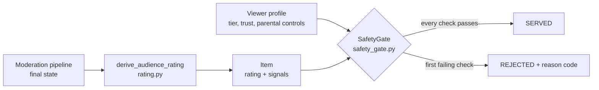

# Explainable Test Guide

**Age-Gated Profile Recommender with Uncertainty-Aware Safety Margins**
How the safety gate works, every test case explained, and a step-by-step procedure for
reproducing the results yourself.

All numbers in this guide were measured on 2026-10-08 from the commands shown. Re-run the
steps and record your own values in the "Your run" columns before quoting them.

---

## 1. What is and is not covered

| Part of the system | State | Covered here |
|---|---|---|
| Audience rating derived from the moderation pipeline's output | Built | Yes |
| Deterministic safety gate (age tier, uncertainty margin, parental controls, escalation) | Built | Yes |
| Hook in the moderation workflow that attaches the rating | Built, off by default | Yes |
| Personalized ranking, Thompson-sampling bandit, drift guard | **Not built yet** | No |
| Moderator queue prioritizer, precedent retrieval, feedback loop | **Not built yet** | No |
| API endpoints, database storage, telemetry | **Not built yet** | No |

So this guide verifies the **safety layer**: the part that decides whether an item may be
shown to a given viewer at all. It does not yet measure recommendation quality (precision,
NDCG, diversity) or queue performance, because those components do not exist yet. A paper
written from these results can claim the gate's rejection behaviour; it cannot yet claim
anything about ranking.

Two further limits to state in any write-up:

- **All data is synthetic.** Harmful content is represented by labels and scores on
  placeholder text ("Placeholder item item-0734 labelled grooming."). No real harmful text
  exists in the project. The results show the gate reacts correctly to what the moderation
  agents *report*; they say nothing about whether the agents detect harmful content.
- **The live Gemini-backed pipeline was not run.** Ratings were derived from constructed
  pipeline states in the same shape the pipeline produces.

---

## 2. How the safety layer works



**Step A - rating.** Each item starts at `all_ages` and rules can only raise it:
`all_ages < teen < adult < blocked`. A rating below `adult` requires the item to be
explicitly approved, every judging agent to have allowed it, toxicity under the limit, no
disallowed violation or flag, and every topic on an allow-list. If any signal is missing or
malformed the rating becomes `adult`. Missing never means safe.

**Step B - gate.** For one viewer and one item the gate runs ten checks in order and stops
at the first failure:

| # | Check | Reason code |
|---|---|---|
| 1 | Item is `blocked` or was removed | `blocked` |
| 2 | Status is not `approved`/`warned` | `pending_review`, `not_servable_status` |
| 3 | Item has no rating (legacy) | `unrated` |
| 4 | Parent blocked the category, or capped the rating | `parental_block` |
| 5 | Item carries an escalation category (child/teen) | `escalation` |
| 6 | Item rating is above the viewer's tier | `above_tier` |
| 7 | Topic not on the tier's allow-list, disallowed violation, or toxicity over the tier limit (child/teen) | `unlisted_topic`, `policy_violation`, `toxicity` |
| 8 | Sensitive teen topic without parental allowance | `sensitive_topic` |
| 9 | Borderline item for a child, or a teen under strict controls | `borderline` |
| 10 | Uncertainty margin: status not exactly approved, confidence signals missing, or agent disagreement too high | `pending_review`, `missing_signals`, `high_uncertainty` |

An item or profile that fails validation is rejected with `invalid`.

**Uncertainty threshold** = `0.45 x trust x strictness`
(trust: verified 1.0, parent_linked 0.85, self_declared 0.7; strictness: low 1.0, medium 0.8, strict 0.6).
An item is too uncertain when disagreement >= threshold or confidence < 1 - threshold.

The gate reads only the viewer's tier, trust level and parental controls. It never reads
interests or learned signals, which is why personalization cannot bypass it.

---

## 3. Setup

Open a terminal (Git Bash) in the project folder:

```
cd /e/Content_Moderation/generative-ai/genai-usecases/content-moderation-system
PY=backend/.venv/Scripts/python.exe
```

In PowerShell use `$PY = "backend\.venv\Scripts\python.exe"` and write `& $PY ...` in place
of `$PY ...`. No internet connection, API key or database is needed for any step.

---

## 4. Step-by-step verification

### Step 1 - Confirm the existing project still works

```
cd backend && .venv/Scripts/python.exe -m pytest tests/ -q ; cd ..
```

Expected: `3 passed`. This is the project's original test suite. It shows the new feature
broke nothing that was previously tested. (It is only three tests; say so.)

### Step 2 - Generate the mock data

```
$PY recommendation/mock_data/generate_mock_data.py
```

Expected output:

```
items: 800
profiles: 80
engagement: 2720
resolved_cases: 200
rejection_cases: 48
```

The seed is fixed (20261008), so the files are identical on every run. To confirm, run it
twice and check `git status` shows no change in `recommendation/mock_data/`.

What is in the data:

| File | Contents |
|---|---|
| `items.json` | 800 items in 13 scenarios, each with the pipeline state that produced it (section 6) |
| `profiles.json` | 80 viewers: 26 child, 28 teen, 26 adult; three trust levels; some with parental controls, risky engagement, or requests for disallowed interests |
| `engagement.json` | 2,720 simulated impressions/clicks; "risky engagement" children mostly interact with adult or blocked items |
| `resolved_cases.json` | 200 resolved moderation cases with the final human action; about a third override the agents |
| `rejection_cases.json` | 48 hand-written named cases: 42 that must be rejected, 6 controls that must be served (section 5) |

### Step 3 - Run the rejection-case catalogue and the full sweep

```
$PY recommendation/evaluation/run_gate_report.py
```

This prints five tables and saves them to `recommendation/results/`:

| Printed table | Saved file | Use in the paper |
|---|---|---|
| 1. Rejection-case catalogue | `stage1_case_results.csv` | Per-rule correctness table |
| 2. Derived rating by scenario | `stage1_rating_accuracy.csv` | Rating accuracy |
| 3. Served per scenario and tier | `stage1_sweep_matrix.csv` | Main result matrix |
| 4. Rejections by reason and tier | `stage1_rejection_reasons.csv` | Why items were withheld |
| 5. Summary | `stage1_gate_report.json` | Headline numbers, leak rate |

Expected last line: `RESULT: all cases as expected, no rating mismatch, no leak`.
The script exits with code 1 if any case fails, so a silent failure is not possible.

What to check by eye in table 1: every row ends in `PASS`, and for every `R` row the
"actual outcome" column starts with `rejected:`.

### Step 4 - Try bad cases by hand

`check_case.py` lets you describe one item and one viewer and see the rating, the reasons
and the decision. Try each of these and compare with the expected result:

| # | Command (after `$PY recommendation/evaluation/check_case.py`) | Expected rating | Expected decision |
|---|---|---|---|
| a | `--tier child` | all_ages | SERVED |
| b | `--tier child --category grooming` | adult | REJECTED (escalation) |
| c | `--tier teen --category violent_extremism --status flagged` | blocked | REJECTED (blocked) |
| d | `--tier adult --status removed` | blocked | REJECTED (blocked) |
| e | `--tier teen --status flagged` | adult | REJECTED (pending_review) |
| f | `--tier child --category news` | adult | REJECTED (above_tier) |
| g | `--tier child --category technology` | teen | REJECTED (above_tier) |
| h | `--tier teen --category technology` | teen | SERVED |
| i | `--tier child --toxicity 0.9` | blocked | REJECTED (blocked) |
| j | `--tier teen --violation hate_speech` | adult | REJECTED (above_tier) |
| k | `--tier child --dissent flag` | adult | REJECTED (above_tier) |
| l | `--tier child --legacy` | unrated | REJECTED (unrated) |
| m | `--tier child --block gaming --category gaming_family` | all_ages | REJECTED (parental_block) |
| n | `--tier teen --category mental_health --topic mental_health` | teen | REJECTED (sensitive_topic) |
| o | `--tier teen --category mental_health --topic mental_health --allow-sensitive mental_health` | teen | SERVED |
| p | `--tier child --drop violation_severity` | adult | REJECTED (above_tier) |
| q | `--tier adult --trust self_declared --legacy` | unrated | REJECTED (unrated) |
| r | `--tier adult --trust verified --legacy` | unrated | SERVED |

Run `$PY recommendation/evaluation/check_case.py --help` for every option, and invent your
own cases. If you find one where a child or teen is served something you think should be
withheld, that is a finding worth recording.

### Step 5 - Run the automated test suite

```
$PY -m pytest recommendation/tests -q
```

Expected: `870 passed, 1 skipped` (about 80 seconds; the mock-data sweep is the slow part).
To run one file: `$PY -m pytest recommendation/tests/test_rec_safety_gate.py -q`.
Section 7 explains what each file tests.

### Step 6 - Confirm the feature is off by default

```
$PY -m pytest recommendation/tests/test_rec_pipeline_hook.py -q
```

Expected: `4 passed`. These show that with `RECOMMENDATION_ENABLED` unset the moderation
pipeline's output is byte-for-byte unchanged, and that a failure inside the rating code
cannot alter a moderation decision.

### Step 7 - Confirm reproducibility

Run Step 3 twice and compare the JSON report:

```
cp recommendation/results/stage1_gate_report.json /tmp/first.json
$PY recommendation/evaluation/run_gate_report.py > /dev/null
cmp /tmp/first.json recommendation/results/stage1_gate_report.json && echo identical
```

Expected: `identical`.

---

## 5. The rejection-case catalogue, explained

Every case starts from the same clean item: approved, topic "science", toxicity 0.02, all
three judging agents approving. Each case changes one thing. "Viewer" is verified unless
stated. All 48 produced the expected outcome.

### 5.1 Blocked content reaches nobody

| Case | What is wrong with the item | Viewer | Result | Working |
|---|---|---|---|---|
| R01 | Status `removed` | adult | rejected: `blocked` | A removed status rates `blocked`; check 1 rejects for every tier |
| R02 | Author was banned for it (`moderation_action = user_banned`) | adult | rejected: `blocked` | A sanction on the author also rates `blocked`, even though status says approved |
| R03 | Approved, but toxicity 0.90 | adult | rejected: `blocked` | Toxicity >= 0.75 rates `blocked` regardless of status |

### 5.2 Rating above the viewer's tier

| Case | Item | Viewer | Result | Working |
|---|---|---|---|---|
| R04 | Topic "news" (not on a minor's list) -> `adult` | child | rejected: `above_tier` | adult (3) > child (1) |
| R05 | Same | teen | rejected: `above_tier` | adult (3) > teen (2) |
| R06 | Topic "technology" -> `teen` | child | rejected: `above_tier` | teen (2) > child (1) |

### 5.3 Unrated legacy items

| Case | Viewer | Result | Working |
|---|---|---|---|
| R07 | child | rejected: `unrated` | No rating means unknown; unknown is withheld from minors |
| R08 | teen | rejected: `unrated` | Same |
| R09 | adult, self-declared age | rejected: `unrated` | A self-declared age may be false, so the safe treatment applies |

### 5.4 Pending review and flagged items

| Case | Status | Viewer | Result | Working |
|---|---|---|---|---|
| R10 | `flagged` | child | rejected: `pending_review` | Only exactly `approved` items reach a minor |
| R11 | `pending_human_review` | teen | rejected: `pending_review` | Same |
| R12 | `under_review` | teen | rejected: `pending_review` | Same |
| R13 | `flagged` | adult | rejected: `not_servable_status` | Nobody is recommended content still under review |
| R14 | `submitted` (never moderated) | adult | rejected: `not_servable_status` | Unmoderated content is not recommendable |

### 5.5 High-risk escalation categories

| Case | Item | Viewer | Result | Working |
|---|---|---|---|---|
| R15 | Label `violent_extremism`, still flagged | adult | rejected: `blocked` | An escalation category not yet approved by a moderator rates `blocked` for everyone |
| R16 | Label `grooming`, moderator-approved | child | rejected: `escalation` | Even when approved for adults, escalation categories stay hidden from minors |
| R17 | Violation `self_harm_promotion`, approved | teen | rejected: `escalation` | The label is found in violations as well as topics |
| R18 | Topic misspelled `selfharm` | teen | rejected: `escalation` | Matching uses word stems with separators removed |
| R19 | `grooming` topic but rating wrongly set to `all_ages` | child | rejected: `escalation` | The gate re-checks the labels itself and does not trust the rating |

### 5.6 Agent disagreement and uncertainty

| Case | Item | Viewer | Result | Working |
|---|---|---|---|---|
| R20 | One of three agents voted `flag` | child | rejected: `above_tier` | Any dissenting agent keeps the rating at `adult` |
| R21 | All agents voted `remove`, status still says approved | child | rejected: `above_tier` | Unanimous "remove" is not agreement to serve |
| R22 | Disagreement 0.50 | child | rejected: `high_uncertainty` | 0.50 >= threshold 0.45 |
| R23 | Confidence 0.30 | teen | rejected: `high_uncertainty` | 0.30 < 1 - 0.45 = 0.55 |
| R24 | Confidence signals missing | child | rejected: `missing_signals` | A missing signal is not treated as certainty |
| R25 | Disagreement 0.33 | teen, self-declared | rejected: `high_uncertainty` | Threshold 0.45 x 0.7 = 0.315; 0.33 >= 0.315 |
| R26 | Disagreement 0.30 | teen, strict parental setting | rejected: `high_uncertainty` | Threshold 0.45 x 0.6 = 0.27; 0.30 >= 0.27 |

Compare R25 with control C04: the same item is served to a *verified* teen (threshold 0.45).
That pair demonstrates "lower trust makes the gate stricter".

### 5.7 Parental controls

| Case | Setting | Item | Viewer | Result | Working |
|---|---|---|---|---|---|
| R27 | Blocked "gaming" | `gaming_family` | child | rejected: `parental_block` | Word-stem match: "gaming" is a word of the topic |
| R28 | Rating cap `all_ages` | teen-rated | teen | rejected: `parental_block` | Parent's cap is below what the tier would allow |
| R29 | Blocked "news" | "news" | adult | rejected: `parental_block` | Controls apply to any profile that has them |

### 5.8 Sensitive and borderline content

| Case | Item | Viewer | Result | Working |
|---|---|---|---|---|
| R30 | Topic `mental_health` | teen, no allowance | rejected: `sensitive_topic` | Sensitive teen topics need an explicit parental allowance (control C05 has it and is served) |
| R31 | Teen item, toxicity 0.30 (borderline) | teen, strict setting | rejected: `borderline` | Borderline = teen-rated with toxicity >= 0.25; hidden under strict controls |

### 5.9 Checks the gate makes independently of the rating

These model a *wrong* rating reaching the gate (a bug, or stale data).

| Case | Item, wrongly rated `all_ages` | Viewer | Result | Working |
|---|---|---|---|---|
| R32 | Topic "general" | child | rejected: `unlisted_topic` | Minors only get allow-listed topics, whatever the rating |
| R33 | Violation `hate_speech` | teen | rejected: `policy_violation` | Violations are checked directly |
| R34 | Toxicity 0.60 | child | rejected: `toxicity` | Toxicity is checked directly (child limit 0.10) |

### 5.10 Missing or malformed pipeline output

| Case | Defect | Viewer | Result | Working |
|---|---|---|---|---|
| R35 | `violation_severity` absent | child | rejected: `above_tier` | Missing signal -> `adult` |
| R36 | A policy flag is present | teen | rejected: `above_tier` | Any flag -> `adult` |
| R37 | `content_category` is null | child | rejected: `above_tier` | Missing category -> `adult` |
| R38 | Action `warned` while status says approved | teen | rejected: `above_tier` | Status and action must both be approved |
| R39 | Status `warned` | adult, self-declared | rejected: `pending_review` | Low-trust adults only get exactly-approved items |
| R40 | Status "approved" with a hidden zero-width character | child | rejected: `pending_review` | Status must match exactly |

### 5.11 Attempts to get around the gate

| Case | Attempt | Viewer | Result | Working |
|---|---|---|---|---|
| R41 | Item altered after rating to an impossible value (disagreement = 7) | child | rejected: `invalid` | The gate re-validates its inputs and rejects what does not validate |
| R42 | Child whose interests and learned signals all point at adult topics | child | rejected: `above_tier` | The gate does not read interests, so they cannot influence it |

### 5.12 Controls - these must be served

A gate that rejected everything would also pass every rejection test, so these matter.

| Case | Item | Viewer | Result |
|---|---|---|---|
| C01 | Clean `all_ages` item | child | served |
| C02 | Clean teen item | teen | served |
| C03 | Adult-rated item | adult | served |
| C04 | Disagreement 0.33 (same item as R25) | teen, verified | served |
| C05 | `mental_health` (same item as R30) | teen with parental allowance | served |
| C06 | Moderator-approved escalation item (same item as R16) | adult | served |

---

## 6. Bulk results: 800 items x 80 profiles

### 6.1 Rating accuracy

Each scenario has an expected rating assigned by the generator, independently of the
rating code. 800 of 800 items received the expected rating.

| Scenario | Items | What it represents | Expected rating | Correct |
|---|---|---|---|---|
| clean_child | 220 | Approved, child-list topic, toxicity < 0.10 | all_ages | 220 |
| clean_teen | 140 | Approved, teen-list topic | teen | 140 |
| sensitive_teen | 30 | Approved, sensitive teen topic | teen | 30 |
| adult_general | 120 | Approved, topic on no minor list | adult | 120 |
| adult_violation | 50 | Policy violation or toxicity 0.35-0.74 | adult | 50 |
| borderline | 40 | Teen topic, toxicity 0.25-0.34 | teen | 40 |
| high_disagreement | 50 | Clean topic but an agent dissented | adult | 50 |
| pending_review | 40 | Flagged / under review | adult | 40 |
| removed | 40 | Removed or author sanctioned | blocked | 40 |
| escalation_pending | 24 | Escalation label, awaiting review | blocked | 24 |
| escalation_approved | 6 | Escalation label, moderator-approved | adult | 6 |
| legacy_unrated | 30 | No rating at all | unrated | 30 |
| malformed | 10 | A pipeline field missing or wrong type | adult | 10 |

### 6.2 Items served (served / evaluated)

| Scenario | Child (26 profiles) | Teen (28 profiles) | Adult (26 profiles) |
|---|---|---|---|
| clean_child | 5394 / 5720 | 5835 / 6160 | 5720 / 5720 |
| clean_teen | **0** / 3640 | 3757 / 3920 | 3640 / 3640 |
| sensitive_teen | **0** / 780 | 60 / 840 | 780 / 780 |
| adult_general | **0** / 3120 | **0** / 3360 | 3120 / 3120 |
| adult_violation | **0** / 1300 | **0** / 1400 | 1075 / 1300 |
| borderline | **0** / 1040 | 842 / 1120 | 1040 / 1040 |
| high_disagreement | **0** / 1300 | **0** / 1400 | 850 / 1300 |
| pending_review | **0** / 1040 | **0** / 1120 | **0** / 1040 |
| removed | **0** / 1040 | **0** / 1120 | **0** / 1040 |
| escalation_pending | **0** / 624 | **0** / 672 | **0** / 624 |
| escalation_approved | **0** / 156 | **0** / 168 | 156 / 156 |
| legacy_unrated | **0** / 780 | **0** / 840 | 510 / 780 |
| malformed | **0** / 260 | **0** / 280 | 251 / 260 |

How to read it:

- Every bold zero is a cell where serving would break a rule, and nothing was served.
- `clean_child` for children is 5394/5720, not 100%: the missing 326 are parental blocks
  and strict-setting rejections on individual profiles, which is the intended behaviour.
- `sensitive_teen` for teens is 60/840: only the profiles whose parent allowed the topic.
- `legacy_unrated` for adults is 510/780: the 270 withheld are self-declared adults.
- `adult_violation` and `high_disagreement` for adults are below 100% because
  self-declared adults fall under the uncertainty margin and do not get `warned` items.

### 6.3 Why items were rejected

| Reason | Child | Teen | Adult | Total |
|---|---|---|---|---|
| above_tier | 8909 | 4867 | 0 | 13776 |
| blocked | 1664 | 1792 | 1664 | 5120 |
| parental_block | 2849 | 2073 | 0 | 4922 |
| pending_review | 1040 | 1120 | 225 | 2385 |
| unrated | 780 | 840 | 270 | 1890 |
| not_servable_status | 0 | 0 | 1040 | 1040 |
| sensitive_topic | 0 | 780 | 0 | 780 |
| high_uncertainty | 38 | 62 | 450 | 550 |
| escalation | 126 | 132 | 0 | 258 |
| borderline | 0 | 240 | 0 | 240 |
| missing_signals | 0 | 0 | 9 | 9 |

Only the first failing check is counted for each item, so a reason that comes late in the
order (for example `high_uncertainty`) looks rarer than the rule's real reach.

### 6.4 Headline numbers

| Metric | Measured | Your run |
|---|---|---|
| Named cases passed | 48 / 48 | |
| Rejection cases correctly rejected | 42 / 42 | |
| Control cases correctly served | 6 / 6 | |
| Items rated as expected | 800 / 800 | |
| Profile x item combinations evaluated | 64,000 | |
| Combinations served | 33,030 | |
| Child/teen combinations evaluated | 43,200 | |
| Child/teen combinations served | 15,888 | |
| Leaks (item served that the ground truth says must be withheld) | 0 | |
| Leak rate | 0.0 % | |
| Automated tests | 870 passed, 1 skipped | |
| Original project tests | 3 passed | |

"Leak" is judged from the scenario labels the generator assigned, not from the gate's own
output, so the measurement is not the gate marking its own homework.

---

## 7. What each test file checks

| File | Tests | What it proves |
|---|---|---|
| `test_rec_rating.py` | 249 (+1 skipped) | Each rating rule; toxicity boundaries; every non-approved status rates at least `adult`; deleting or corrupting any single input never lowers the rating; escalation spelling variants; agent agreement including human review |
| `test_rec_safety_gate.py` | 537 | The full rating x tier x trust matrix; blocked never served; unrated handling; every backend status; uncertainty margin and its scaling; parental controls; escalation; allow-lists; tampered items; invalid profiles |
| `test_rec_gate_invariants.py` | 4 | 12,000 random profile/item pairs against an independent oracle; decisions unchanged when interests and learned signals are removed; the final check never adds an item |
| `test_rec_mock_data.py` | 76 | Mock data is reproducible, in the specified size ranges and placeholder-only; all 48 named cases; every gate reason code is exercised; zero leaks over 64,000 combinations; lower trust never sees more; parental controls never widen |
| `test_rec_pipeline_hook.py` | 4 | The workflow hook is inert when the flag is off and cannot change a moderation outcome |

The one skipped test is deliberate: it would treat toxicity `0` as a malformed value, which
it is not.

---

## 8. Template results table for the paper

Fill the right-hand column from your own Step 3 and Step 5 output.

| Experiment | Measure | Value |
|---|---|---|
| E1 Rule-level correctness | Rejection cases correctly rejected (of 42) | |
| E1 | Control cases correctly served (of 6) | |
| E2 Rating derivation | Items given the expected rating (of 800) | |
| E3 Tier enforcement | Above-tier items served to child profiles | |
| E3 | Above-tier items served to teen profiles | |
| E4 Blocked content | Blocked / removed items served to any profile | |
| E5 Escalation categories | Escalation items served to child or teen | |
| E6 Uncertainty margin | High-disagreement items served to child or teen | |
| E6 | Pending / flagged items served to any profile | |
| E7 Legacy handling | Unrated items served to child, teen or self-declared adult | |
| E8 Malformed input | Malformed-state items served to child or teen | |
| E9 Trust monotonicity | Tiers where self-declared saw more than verified (of 3) | |
| E10 Parental controls | Profiles where controls widened the feed | |
| E11 Utility retained | Clean child items served to child profiles (%) | |
| E11 | Clean teen items served to teen profiles (%) | |
| E12 Overall | Leak rate over 64,000 combinations (%) | |
| E13 Reproducibility | Report identical across two runs (yes/no) | |

E3 to E8 are the bold-zero cells of table 6.2. E9 and E10 are asserted by
`test_lower_trust_never_sees_more` and
`test_parental_controls_never_widen_except_the_sensitive_allowance`; they pass, which means
the values are 0. E11 is 5394/5720 = 94.3 % and 3757/3920 = 95.8 %.

---

## 9. What to say honestly in the paper

- **Scope.** These experiments evaluate a deterministic safety gate on synthetic data.
  Personalization, the bandit and the moderator queue are designed but not implemented or
  evaluated.
- **A 0 % leak rate on mock data is not a 0 % leak rate in the world.** The gate acts on
  what the moderation agents report. If the agents miss harmful content and approve it with
  clean signals on a child-list topic, the gate will serve it.
- **Self-declared age can be false.** An account with no declared tier is treated as an
  adult by project decision.
- **Confidence scores are weak.** Most agents in this pipeline report a fixed constant, so
  the uncertainty margin is driven mainly by disagreement between verdicts.
- **Topic allow-lists are restrictive.** The real pipeline writes free-form categories
  (default "general"), which rate `adult`. On real data child and teen feeds would be
  nearly empty until the pipeline uses a controlled topic vocabulary.
- **Stem matching is not language understanding.** It catches spelling variants of known
  labels, not new slang, other languages or text inside images.
- **Novelty.** This is a composition of known techniques (rule-based content rating,
  allow-list filtering, fail-closed defaults, ensemble disagreement as an uncertainty
  signal), not a new algorithm.
- **Independent review.** A separate reviewer attacked the gate twice and found real leaks
  both times, which were fixed. The fixes from the second pass have not yet been
  independently re-reviewed. Details: `recommendation/results/RESULTS.md`.
