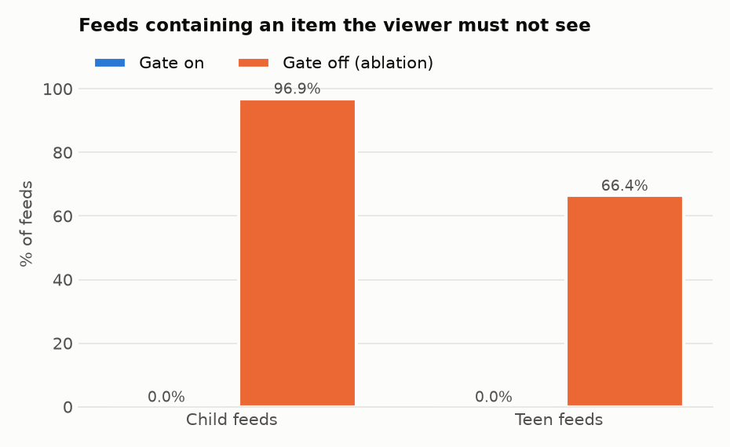
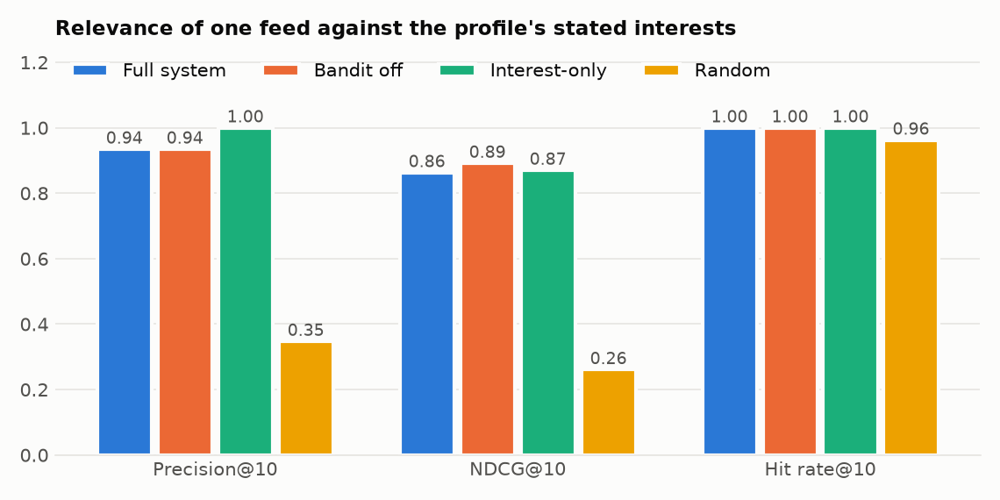
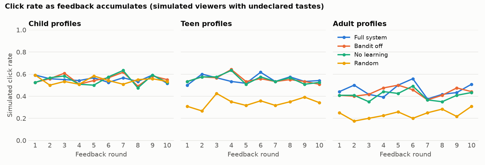
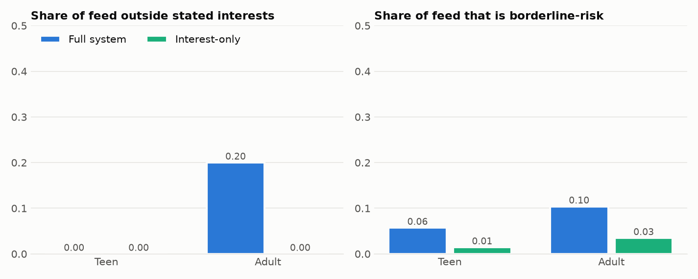
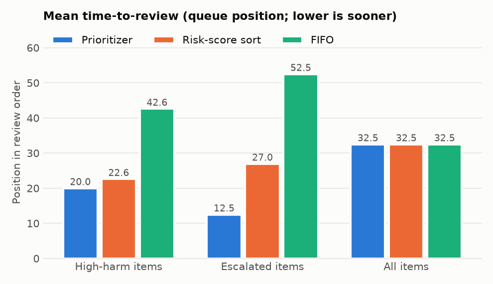
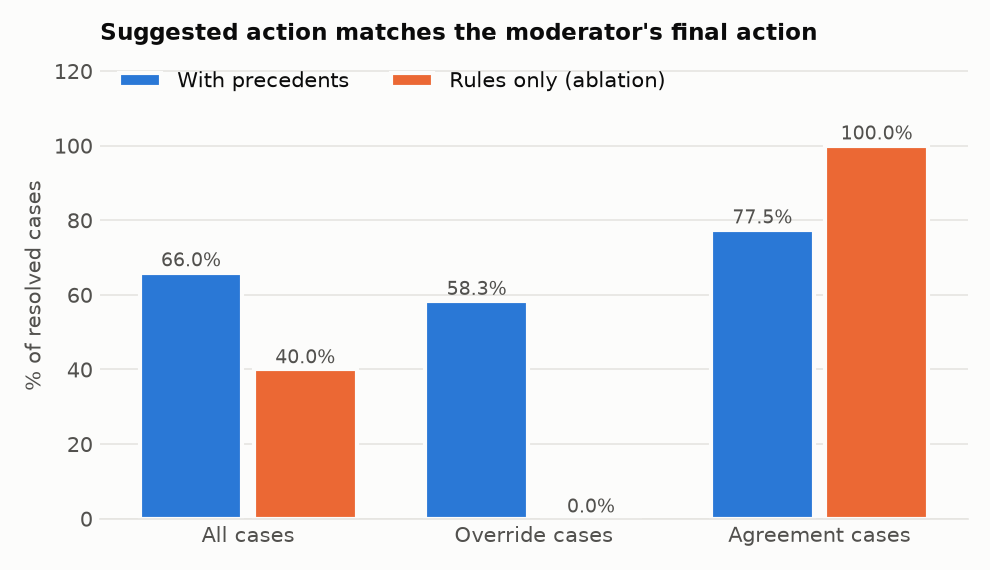

# Results

Real output from real runs only. Nothing below is estimated. Where a result is weak,
negative or follows from how the mock data was built, the text says so.

## Status

| Stage | State |
|---|---|
| 0 - baseline and findings | done |
| 1 - audience rating and safety gate | done, reviewed three times |
| 2 - profiles, storage, personalization | done, independently reviewed once, findings fixed |
| 3 - moderator queue, feedback, endpoints | done, independently reviewed once, findings fixed |
| 4 - evaluation, final review | done |
| Profile page (frontend) | written, builds; not run in a browser |

## Test outcomes (2026-10-08)

| Suite | Command | Result |
|---|---|---|
| Host suite, baseline (before any change) | `cd backend && .venv/Scripts/python.exe -m pytest tests/ -q` | 3 passed |
| Host suite, after Stage 1 | same | 3 passed |
| Host suite, after Stages 2 and 3 | same | 3 passed |
| Host suite, after Stage 4 and the final-review fixes | same | 3 passed |
| Recommendation tests | `backend/.venv/Scripts/python.exe -m pytest recommendation/tests -q` | 1146 passed, 1 skipped (about 4 minutes) |

| Test file | Passed |
|---|---|
| `test_rec_rating.py` | 253 (+1 skipped) |
| `test_rec_safety_gate.py` | 537 |
| `test_rec_gate_invariants.py` | 4 |
| `test_rec_mock_data.py` | 76 |
| `test_rec_pipeline_hook.py` | 7 |
| `test_rec_store.py` | 64 |
| `test_rec_personalization.py` | 37 |
| `test_rec_feed_service.py` | 11 |
| `test_rec_queue_feedback.py` | 43 |
| `test_rec_api.py` | 65 |
| `test_rec_final_review.py` | 49 |

The skip is deliberate: a parametrised case that would test `toxicity_score = 0` as a
malformed value, which it is not.

Regression status: no previously passing test fails. The host suite is 3 tests and does not
exercise the existing API, so this is weak evidence; see `docs/00_codebase_findings.md`.

### Gate invariant run

Seed 20261008, 300 random profiles x 40 random items.

| | |
|---|---|
| Profile/item combinations evaluated | 12,000 |
| Items the gate passed | 1,540 |
| Of those, passed to a child or teen | 434 |
| Passed items that broke a safety rule (independent oracle) | **0** |

Further seeded checks, all passing: 1,500 pairs where the gate decision is identical with
and without interests, learned weights and feed history; 200 pools where the final-output
check returns exactly the pool-filter survivors; 2,000 child profiles against teen, adult
and blocked items with zero passes.

This run covers the gate in isolation. The next section covers the full feed path.

## Stages 2 and 3

### Invariant through the whole feed path

`test_no_leak_through_the_full_feed_path_whatever_the_personalization_state`, seed 20261008.
Every one of the 80 mock profiles requests 13 feeds over all 800 mock items. Before each
feed the profile's explicit interests, learned weights and feed history are replaced with
random values that include escalation and adult topics, and the bandit is trained with
random rewards. Each served item is checked against the generator's ground-truth labels and
re-checked by the gate against the profile as stored.

| | |
|---|---|
| Feeds built | 1,040 |
| Items served | 23,150 |
| Of those, served to a child or teen | 15,495 |
| Served items that break a safety rule | **0** |

Also verified: a ranker that injects rejected or invented items, and a ranker that rewrites
an item's rating, both have their additions removed by the final gate; a profile record
that has lost its tier gets the child feed.

### Personalization versus a random baseline

Precision@10 on the mock data, where an item counts as relevant if one of its topics is in
the profile's explicit interests. Same gate survivors for both; 80 profiles.

| | Precision@10 |
|---|---|
| Ranker (TF-IDF relevance + bandit, seed 5) | 0.935 |
| Random 10 of the gate survivors (seed 11) | 0.349 |

Read this with care: the relevance label is defined from the same topic labels the ranker
uses, on synthetic data, so it shows the ranker does what it is built to do, not that
people would find the feed relevant. The comparison against an interest-only baseline,
NDCG and the ablations are in "Offline evaluation" below; the ranker does not beat the
interest-only baseline there.

### Guards (unit-level, on constructed pools)

| Check | Result |
|---|---|
| Borderline items in a 10-item feed, pool 50 % borderline | teen 1 (cap 15 %), adult 3 (cap 30 %) |
| Same, with 20 borderline items already in recent history | 0 |
| Adult with one interest, 40 matching items and 10 others | 2 of 10 slots from outside the interest (20 % minimum) |
| Teen on the equivalent pool (no diversity guard) | 0 of 10 |
| Child engaging 50 times each with four non-explicit topics | 0 topics added |
| Learned topics outside the explicit set after engaging with every topic | teen 3, adult 8 (the limits) |

### Moderator queue and feedback

| Check | Result |
|---|---|
| High-harm high-disagreement item versus low-harm unanimous item | ranked first and last of four |
| Escalated item with the lowest possible score versus the worst ordinary item, bandit trained 200 times against it | escalated item first |
| Five overrides in one category, five agreements in another | overridden category's item moves ahead; precedent suggestion becomes the moderators' action |
| Approving a blocked escalation item | rating becomes `adult`; still absent from child and teen feeds |

Time-to-review against FIFO and a plain risk sort is in "Offline evaluation", section E.

### API and RBAC

65 API tests through FastAPI's `TestClient`, using the host's own `get_current_user` and
`get_moderator` with a real `AuthDatabase`, on the dual store.

| Check | Result |
|---|---|
| All 6 endpoints without a token | 401 |
| All 6 endpoints with an invalid token | 401 |
| Queue and item recommendation as a plain user | 403 |
| Escalated items as `moderator` / `content_analyst` | withheld from the queue, 403 on the item and on resolving it |
| Escalated items as `senior_moderator`, `policy_specialist`, `admin` | visible, first in the queue |
| Child requesting disallowed interests | 422 with the rejected topics; nothing saved |
| Owner changing trust level or parental controls | 403 |
| Owner raising their tier | 403; lowering allowed |
| Reading or changing another user's profile | 403 (admin allowed) |
| Routes with the flag off / on (import of `backend/main.py`) | 62 / 68 |

### Both databases

Every storage test runs three times: SQLite, Firestore and the dual store. The API tests
run on the dual store.

**Firestore was tested against an in-memory fake (`tests/fakes.py`), not a real Firestore
or an emulator**, because the project has neither and tests must not use the network. This
verifies the store's logic and the fallback behaviour during a simulated outage. It does not
verify behaviour against the real service.

## Mock-data replay (rating and gate only)

Command: `backend/.venv/Scripts/python.exe recommendation/evaluation/run_gate_report.py`.
Raw tables: `stage1_case_results.csv`, `stage1_rating_accuracy.csv`,
`stage1_sweep_matrix.csv`, `stage1_rejection_reasons.csv`, `stage1_gate_report.json`.
The report is byte-identical across two runs.

| | |
|---|---|
| Named cases as expected | 48 / 48 (42 rejections, 6 controls served) |
| Items given the rating their scenario expects | 800 / 800 |
| Profile x item combinations evaluated | 64,000 (80 profiles x 800 items) |
| Combinations served | 33,030 |
| Child/teen combinations evaluated / served | 43,200 / 15,888 |
| Leaks against the generator's ground-truth labels | **0** |
| Clean child items served to child profiles | 5394 / 5720 (94.3 %); the rest are parental blocks and strict settings |
| Clean teen items served to teen profiles | 3757 / 3920 (95.8 %) |

Every scenario that must not reach a minor (adult, violation, high disagreement, pending,
removed, escalation, legacy, malformed) was served to child and teen profiles 0 times.
Pending, removed and escalation-pending items were served to nobody.

What this does not show: the data is synthetic and labelled by the same generator that
built it, so it tests that the gate reacts correctly to reported signals, not that real
harmful content would be detected. Ranking, the bandit, the queue and the API do not exist
yet and are not measured. Case-by-case explanations are in
`docs/EXPLAINABLE_TEST_GUIDE.md`.

## Offline evaluation (Stage 4)

Command: `backend/.venv/Scripts/python.exe recommendation/evaluation/run_evaluation.py`
(about 4 minutes). Seed 20261008, feed size 10, replay on the mock data only. Raw numbers:
`evaluation_metrics.json` and `evaluation_*.csv`. `evaluation_metrics.json` is
byte-identical across two runs.

Several of these results are unflattering. They are reported as measured.

### A. Leak rate in child and teen feeds

5 feeds per child and teen profile (54 profiles, 270 feeds per system). "Gate off" is the
ranker called directly on every mock item; it exists only as an ablation.

| System | Tier | Feeds | Feeds with an above-tier item | Above-tier items served | Feeds with a later-flagged item |
|---|---|---|---|---|---|
| Gate on | child | 130 | **0 (0.0 %)** | 0 | 24 (18.5 %) |
| Gate on | teen | 140 | **0 (0.0 %)** | 0 | 19 (13.6 %) |
| Gate off | child | 130 | 126 (96.9 %) | 424 | 18 (13.8 %) |
| Gate off | teen | 140 | 93 (66.4 %) | 229 | 16 (11.4 %) |

- Target met: 0 % of gated feeds contain an above-tier, blocked, pending or unrated item.
- Without the gate, almost every child feed does.
- **The later-flagged rate is not zero, and the gate does not reduce it.** "Later flagged"
  is a seeded 3 % of the items that look clean today (approved, child- or teen-rated) and
  are assumed to be flagged by a later review. The gate has no signal for them. 18.5 % of
  child feeds and 13.6 % of teen feeds contain one. The rate is slightly higher with the
  gate on only because gated feeds are made entirely of the clean-looking pool those items
  are drawn from. This is the residual risk of trusting the classifiers, and 3 % is an
  assumption, not a measurement.

### B. Relevance of a single feed

80 profiles. Relevance is graded from the profile's own stored interests and weights.

| System | Precision@10 | NDCG@10 | Hit rate@10 |
|---|---|---|---|
| Full system | 0.935 | 0.863 | 1.000 |
| Bandit off (ablation) | 0.935 | 0.892 | 1.000 |
| Interest-only baseline | **1.000** | 0.870 | 1.000 |
| Random | 0.348 | 0.261 | 0.963 |

- All three rankers are far above random.
- **The full system does not beat the interest-only baseline on a single feed.** Its
  precision is lower (0.935 against 1.000) because the adult diversity guard deliberately
  gives 2 of 10 adult slots to topics outside the interests: 26 adults at 0.8 and 54 others
  at 1.0 average 0.935. That is the guard working, and it costs exactly this much.
- NDCG: bandit off (0.892) > interest-only (0.870) > full system (0.863). Using the stored
  weights helps ordering; adding bandit exploration noise takes that gain back on a
  one-shot measurement.
- The relevance labels come from the same topic labels the rankers use, on synthetic
  profiles. This says the ranking is consistent with the profile, not that people would
  like the feed.

### C. Learning from feedback (bandit ablation)

36 simulated viewers (12 per tier), 10 rounds. Each likes their declared interests
(click probability 0.5) and, more, two topics they never declared (0.8); everything else
0.05. Click outcomes are seeded per viewer, round and item, so variants are comparable.

| Variant | Child | Teen | Adult |
|---|---|---|---|
| Full system (bandit + learned interests) | 0.554 | 0.552 | **0.454** |
| Bandit off, learned interests on | 0.555 | 0.553 | 0.435 |
| No learning | 0.548 | 0.553 | 0.408 |
| Random | 0.541 | 0.343 | 0.237 |

Overall simulated click rate. By round: `evaluation_bandit_by_round.csv`.

- **Adults: a small gain.** 0.408 with no learning, 0.435 with learned interests, 0.454
  with the bandit as well. The curves are noisy and there is no clear upward trend over 10
  rounds; with 12 viewers per tier this is weak evidence.
- **Teens: no measurable effect** (0.552 to 0.553).
- **Children: no effect, by design.** A child's learned signals cannot add a topic and
  exploration is limited to the explicit set, so undeclared tastes are never discovered.
  For a child, even random selection among gate survivors scores about the same (0.541),
  because the child pool is small and every item in it is on a child-safe topic.
- Honest reading: on this simulation the bandit is not shown to matter much. Ten rounds of
  ten items is little data for per-topic arms shared across viewers, and the feed does not
  avoid repeating items.

### D. Diversity and drift

Mean per feed, from the feeds of section B.

| System | Tier | Distinct topics | Share outside stated interests | Borderline-risk share |
|---|---|---|---|---|
| Full system | teen | 4.04 | 0.00 | 0.057 |
| Full system | adult | 5.04 | **0.20** | 0.104 |
| Interest-only | teen | 4.71 | 0.00 | 0.014 |
| Interest-only | adult | 5.00 | 0.00 | 0.035 |
| Random | teen | 7.96 | 0.70 | 0.064 |
| Random | adult | 8.65 | 0.79 | 0.139 |

- The adult diversity guard does what it is set to: exactly 20 % of adult slots are outside
  the stated interests, against 0 % for the interest-only baseline.
- Borderline share stays under the caps (teen 15 %, adult 30 %): 5.7 % and 10.4 %.
- **The full system serves more borderline content than the interest-only baseline**
  (teen 5.7 % against 1.4 %). The drift guard is a cap, not a minimiser, and bandit
  exploration brings in borderline items that a strict interest sort happens to rank low.
  If minimising borderline exposure is the goal, the cap should be lowered or a penalty added.
- Teens get slightly fewer distinct topics from the full system than from the baseline
  (4.0 against 4.7). There is no diversity guard for teens.
- The trend penalty (rising risk over consecutive feeds) is covered by a unit test only;
  this replay does not build a rising sequence.

### E. Review queue

64 mock items awaiting review. One item is reviewed per step, so time-to-review is the
position in the order. "High harm" is ground truth from the generator: an escalation
category awaiting review, or toxicity at or above 0.5 (35 items).

| Policy | High-harm items | Escalated items | All items | High-harm in the first 35 | Exposure-weighted wait |
|---|---|---|---|---|---|
| Prioritizer | **20.0** | **12.5** | 32.5 | 88.6 % | **1466.9** |
| Risk-score sort | 22.6 | 27.0 | 32.5 | 74.3 % | 1680.8 |
| FIFO | 42.6 | 52.5 | 32.5 | 28.6 % | 2289.2 |

- High-harm items are reviewed about twice as soon as under FIFO, and somewhat sooner than
  under a plain risk sort.
- Most of the advantage over the risk sort comes from escalated items (12.5 against 27.0),
  which the prioritizer puts first by rule. Since "high harm" is defined to include
  escalation categories, part of this result follows from the definition.
- Mean position over all items is 32.5 for every policy, as it must be: prioritising some
  items delays others.
- The learned multiplier played no part here (no overrides were replayed before ordering).

### F. Precedent retrieval (ablation)

Leave-one-out over the 200 resolved cases, k = 5.

| System | All cases | Override cases (120) | Agreement cases (80) |
|---|---|---|---|
| With precedents | **66.0 %** | 58.3 % | 77.5 % |
| Rules only | 40.0 % | 0.0 % | 100.0 % |

Read this one with the most care:

- **The mock data was built so that precedents can help.** Each category has a "house
  norm" action that the simulated moderator follows 80 % of the time. Retrieval by category
  recovers that norm; fixed rules on toxicity cannot know it. The result shows the
  mechanism works when such structure exists. It is not evidence that real moderation
  decisions have that structure.
- **Rules-only scores 0 % and 100 % on the two groups by definition**: an "override" is a
  case where the human differed from the rule-based verdict.
- With precedents the suggestion is wrong on 22.5 % of the cases where the rules were
  already right. Precedents trade some agreement accuracy for override accuracy.
- 80 % is the ceiling by construction; 66 % is below it.

### What the evaluation supports, in one place

| Claim | Supported? |
|---|---|
| The gate keeps above-tier, blocked, pending and unrated items out of child and teen feeds | Yes, on mock data: 0 of 270 feeds, against 219 of 270 without it |
| The gate removes the risk of content the classifiers got wrong | No. 14 to 18 % of gated feeds contain a simulated later-flagged item |
| Personalization beats random | Yes |
| Personalization beats an interest-only sort | No on precision; marginal on NDCG without the bandit |
| The bandit improves engagement | Weakly, adults only, noisy |
| Guards hold their limits | Yes: 20 % diversity slots, borderline under cap |
| The system minimises borderline exposure | No: more than the interest-only baseline |
| The prioritizer reviews high-harm items sooner than FIFO and a risk sort | Yes, largely because escalation is first by rule |
| Precedents improve suggestions | Only on data constructed to have category norms |

## Live run through the real pipeline (2026-10-09)

Command: `backend/.venv/Scripts/python.exe recommendation/evaluation/run_live_demo.py`.
Output: `live_demo_report.txt`, `live_demo_results.json`.

16 invented posts, two with image URLs, plus four generated test images, were put through
the real LangGraph workflow with `USE_ML_MODELS=true` and `RECOMMENDATION_ENABLED=true`.

| Part | In this run |
|---|---|
| LangGraph workflow, all agents, routing, human-review triggers | real |
| ML toxicity model | real: `unitary/toxic-bert` on CPU, from the local cache |
| Policy keyword checks, reputation scoring, media and image heuristics | real |
| Audience rating, gate, feed, queue, precedents, feedback | real |
| **Language model** | **stand-in.** No Gemini or Claude call. `evaluation/standin_llm.py` answers the agents' prompts from keyword lists. Topic and category come from it |
| Databases | temporary folder; the project's database files were not touched |

The project's default ML model (`distilbert_toxic`) is not in the local cache, so the run
used `toxic_bert`, which is. The ensemble was off.

### What happened to each post

| Post | ML toxicity | Pipeline outcome | Rating | Reached |
|---|---|---|---|---|
| Science fair volcano | 0.00 | approved | all_ages | everyone |
| Puppy and kitten | 0.00 | approved | all_ages | everyone |
| Football match | 0.00 | approved | all_ages | everyone except the child whose parent blocked sports |
| Python bug, phone review | 0.00 | approved | teen | teens and adults |
| Nightclub opening | 0.00 | approved | adult | adults |
| Exam stress and anxiety | 0.00 | held for human review (sensitive content) | adult | nobody |
| Stock tips before the election | 0.00 | held for human review (sensitive content) | adult | nobody |
| Insults aimed at a person | 0.99 | flagged | blocked | nobody |
| "That referee was stupid" | 0.87 | flagged | blocked | nobody |
| Spam phrases | 0.00 | held for human review (agents disagreed) | adult | nobody |
| "Secret truth, guaranteed cure" | 0.00 | held for human review (agents disagreed) | adult | nobody |
| Drawing, with an ordinary image URL | 0.00 | approved | adult (media risk medium) | adults |
| Match photos, image URL containing "nsfw" | 0.00 | approved | adult (media risk high) | adults |
| Charity talk on suicide prevention | 0.00 | removed (keyword "suicide") | blocked, escalation | nobody |
| Volcano puzzle | 0.00 | approved | all_ages | everyone |

Feeds: the verified child got 4 items, the child with sports blocked got 3, both teens 6,
both adults 9. Nothing blocked, flagged or held for review reached anyone. The queue held
the 6 items awaiting review; resolving one as "remove" stored a precedent and shortened
the queue to 5.

### Two defects this run found in the rating, both fixed

The mock data could not have shown either, because it was written to my assumptions.

1. **Approved content has no `moderation_action`.** The workflow ends after reputation
   scoring for approved posts, so the enforcement agent that writes that field never runs.
   The rating required it to be exactly `approved`, and so rated every clean post `adult`.
   Now an absent action is accepted; an action that is present must still be `approved`.
2. **The ReAct synthesis step reports about 0.1 as its confidence.** It is a weighted score,
   not a probability. The rating took the lowest confidence of any agent, so every item
   failed the uncertainty margin. That step's verdict is still counted; its score is not.

Before these fixes, on the first live run, child and teen feeds were empty. This is the
second time real behaviour differed from what the mock data assumed; more differences
should be expected once a real language model is connected.

### Behaviour of the existing platform seen in this run (not changed)

- **Any image URL raises media risk.** `score_media_urls` gives a single ordinary image
  URL a score of 0.40 ("medium"), so the rating makes every post with an image `adult`.
  The score depends only on the file name.
- **A plain skin-coloured square is rated "severe" and unsafe** by the pixel heuristic in
  `analyze_uploaded_image` (score 1.0). A plain dark red square is "medium".
- **"Suicide prevention" is removed.** The keyword check matches the word "suicide" and
  sets severity critical, whatever the context.
- **`toxic-bert` is harsh on mild rudeness**: "that referee was stupid" scored 0.87 and
  was flagged, which the rating then blocks (toxicity at or above 0.75).
- **Sensitive topics pause for human review** (mental health, politics, finance).

### What this run does not show

- How the pipeline behaves with a real language model. Category and topic extraction, the
  toxicity second opinion and the written explanations came from keyword rules. A real
  model will produce free-form categories, most of which are on no allow-list and will
  therefore rate `adult` until the topic vocabulary is controlled.
- Anything about real content. All 16 posts are short invented sentences.
- The HTTP layer and the running server; the workflow was called directly.

## Independent review of the gate

A separate subagent with a fresh context was given the nine safety rules and the four
source files, not the tests, docs or design reasoning, and asked to get a withheld item to
a child or teen. It ran its own scripts. It reviewed twice.

### Pass 1 - on the first Stage 1 implementation

The reviewer found leaks. The tier ordering itself held: no above-tier, blocked, unrated
or non-approved item got past the gate with validated models.

| # | Severity | Finding | Fix |
|---|---|---|---|
| 1 | Leak | `policy_flags` was used only for exact escalation matching; a string, a dict, or flags such as `suicide`, `csam`, `sexual_content` rated `all_ages` | Any non-empty or malformed `policy_flags` rates `adult` |
| 2 | Leak | Missing or falsy `violation_severity`, `media_risk_level`, detection booleans, violations, `moderation_action` read as "nothing found" | Every one of these must be present and well-formed, else `adult` |
| 3 | Leak | Default strictness was `medium`, so setting `low` widened the gate | `low` is the default and the baseline; other levels only tighten |
| 4 | Leak | Parental block was an exact match: blocking `gaming` did not block `gaming_family`; look-alike characters matched nothing | Word-level matching; non-ASCII parental labels rejected at validation |
| 5 | Leak (gate alone) | Escalation check missed `selfharm`, `suicide`, `extremism`, `groomer` and Unicode variants when the rating came from elsewhere | Stem matching on separator-free labels; gate now requires allow-listed topics for minors regardless of rating |
| 6 | Weakness | Disagreement measured only the largest verdict group: unanimous "remove" scored 0.0; a human-review entry zeroed it whatever its verdict or position | Rating below `adult` requires every judging agent to allow, or a human approval as the last decision |
| 7 | Weakness | `moderation_action` values `flagged`, `warned`, `remove` were ignored | Must be exactly `approved` |
| 8 | Weakness | `model_copy`, `model_construct` and attribute assignment bypassed validation; an unknown trust level switched the margin off | Gate re-validates both inputs and rejects on failure; `validate_assignment`; margin is on unless trust is positively parent-linked or verified |
| 9 | Weakness | Sensitive-topic check was exact match | Covered by the topic allow-list and stronger normalisation |

### Pass 2 - same reviewer, on the fixed code

It re-ran every pass-1 reproducer: 1, 3, 5, 7, 8, 9 rejected; 2, 4, 6 partly closed. It
found three remaining end-to-end leaks and several weaknesses.

| # | Severity | Finding | Fix |
|---|---|---|---|
| A | Leak | A missing or non-string `content_category` was dropped instead of raising the rating | Category must be a non-empty string, else `adult` |
| B | Leak | Decisions from the two bookkeeping agents were skipped even when the verdict was `remove` or `needs_review` (the pipeline does emit those on error paths) | Only their approvals are skipped; names matched exactly |
| C | Leak | Parental block missed plurals and word order: `sport` vs `sports`, `games` vs `gaming_family`, `kids music` vs `music_kids` | Stem-based, order-independent word matching |
| D | Weakness | Normalisation stripped punctuation, so `!none`, `safe?`, `approve?` read as the safe value | Enumerated fields use a strict normaliser that keeps punctuation |
| E | Weakness | The gate never read `toxicity_score` | Minors need a known score under the tier's limit (child 0.10, teen 0.35) |
| G | Weakness | The gate dropped empty labels that the rating treats as malformed | Empty labels fail the allow-lists for minors |
| I | Note | Trusted adults were served loosely matched statuses such as `approved!` | Status matched exactly for everyone |
| J | Note | A violations list of `["none"]` was rejected for minors | "No violation" markers are recognised |

Each fix has a regression test in `tests/test_rec_rating.py` or `tests/test_rec_safety_gate.py`.

### Final review - a new reviewer, whole feature (Stage 4)

A third review, by a fresh subagent that had seen none of the earlier work, covered all of
`recommendation/src` under ten rules (the nine above plus access control). It also re-covered
the Stage 1 pass-2 fixes. It ran a 40,000-item fuzz of the gate across nine tier and trust
combinations and found no way through the gate itself with well-formed stored data.

It did get forbidden items served to child profiles, and access rules bypassed, through the
layers around the gate. Each needs a precondition, given in the table.

| # | Severity | Finding | Precondition | Fix |
|---|---|---|---|---|
| L1 | Leak | One unreadable value in a stored profile produced a bare child fallback with no parental controls and `tier_declared` false; the next feed wrote that fallback over the record, after which the child could raise themselves to adult | A damaged, partial or legacy profile record | The fallback is now child, strict, capped at `all_ages`, keeps readable parental blocks, is never written back, and only an admin can repair it (409 otherwise). Raising a tier is admin-only in every case |
| L2 | Leak | A failed Firestore write was swallowed while reads preferred Firestore, so a removal or a tier change silently did not take effect and the API reported success | A transient Firestore error | Failed writes are recorded in SQLite; until a document reaches Firestore, reads of it come from SQLite |
| L3 | Leak | A second pipeline run for the same content re-stored it as approved, undoing a moderator's removal | The host calling the hook again for the same content id | A human-reviewed item is never made more permissive by a machine re-rating; a removed one is left alone |
| L4 | Leak (access) | Resolved escalated cases, including the senior's notes, were returned to ordinary moderators as precedents for other items | A resolved escalated case | Escalated precedents are filtered out for non-senior roles, by flag and by label |
| W1 | Weakness | An item a moderator escalated was not treated as escalated: not senior-only, not first | - | The `escalate` action sets the flag; status `escalated` counts as escalated |
| W2 | Weakness | High-risk items with a status outside a short list never entered the queue; an agent-approved high-risk item was rated `adult` and served to adults unreviewed | - | Unreviewed high-risk items are queued whatever their status. A high-risk item is `blocked` until a human moderator has approved it; agent approval alone is no longer enough |
| W3 | Weakness | Escalation matching missed a term split across two labels, leetspeak and look-alike characters | - | Split terms are now caught. Leetspeak and look-alikes are not; see below |
| W4 | Weakness | Profile updates are read-modify-write with no version check, so concurrent requests can lose an update | Multiple workers | **Not fixed.** See below |
| W5 | Weakness | A stored item missing its `is_borderline` flag passed a strict teen profile | - | The gate derives borderline from toxicity itself |
| W6 | Weakness | An `async` moderator dependency would have made the override check always pass | Not the case for the host today | Router creation refuses a coroutine dependency |
| W7 | Weakness | Toxicity given as text such as `"0"`, `" 0 "` or an Arabic-Indic zero was parsed as a clean score | Malformed pipeline output | Only real numbers are accepted |
| W8 | Weakness | Parental blocks made only of filler words ("the") validated and matched nothing | - | Rejected at validation. A block naming a topic the system does not use still validates |
| Note | - | Approving a flagged item that was already rated for minors made it servable to a child | A hand-built item | A moderator approve or warn rates the item `adult` at most |
| Note | - | An item with no content id was stored under the id "None" | - | Not stored |

Each fix has a regression test in `tests/test_rec_final_review.py`.

### What has not been verified, and what was left open

- **The final-review fixes have not been independently re-checked.** They pass the
  regression tests I built from the reviewer's reproductions. This is the same position the
  pass-2 fixes were in until this review covered them.
- **W4, lost updates under concurrency, is not fixed.** Profiles, bandit arms and feed
  history are read, changed and written back whole. With one server process the request
  handlers do not interleave; with several workers an admin's change to a profile can be
  overwritten by a feed request for the same profile that started earlier. A fix needs
  versioned writes or per-field updates in both stores.
- **Storage failures on re-moderation.** If an item was stored as servable and a later
  run rates it `blocked` but the write fails, the servable copy stays until a later write
  succeeds. The same holds for items moderated while the feature flag is off: `rec_items`
  is not updated and should be rebuilt after the flag has been off.
- **Escalation vocabulary.** Leetspeak ("su1cide"), look-alike characters, and terms
  outside the stem list ("pro ana", "child predator") are not recognised as escalation.
  Such items are still kept from minors by the topic allow-lists, but they are not sent to
  the front of the queue or restricted to senior moderators.
- **A human approval sets disagreement to zero.** An item a human approved is rated on
  its other signals even if an agent voted to remove it. That is the intended meaning of
  human review, and it means the disagreement check does not apply to human-approved items.
- **Small information exposures, left as they are:** the feedback endpoint tells any user
  whether an item id exists; the feed's rejection summary tells the viewer how many items
  were withheld per reason; ordinary moderators see the count of escalated items withheld.
- **Scale.** `list_items` reads at most 5,000 items ordered by id; beyond that, items
  would be neither served nor queued.
- Reviewer finding F stands by design: an item supplied with disagreement 0.33 and
  confidence 0.9 passes a verified child, because that is under the 0.45 threshold. Through
  the rating derivation such an item is `adult` anyway.
- Reviewer note H stands: a profile whose tier is lost in storage re-validates to the adult
  default. This follows from the chosen default and is the storage layer's job to prevent
  (Stage 2).
- Reviewer note: escalation stems miss terms such as "child abuse", "sextortion", "pro-ana"
  and leetspeak. Minors are still protected by the topic allow-list; the effect is on
  blocked-versus-adult for unapproved items and on queue escalation.

## Known limitations

See `docs/02_safety_policy.md`. The two that matter most for reading these results:

- The real pipeline has been run only with a rule-based stand-in for the language model
  (see "Live run"). No Gemini or Claude call has been made.
- Real Firestore has not been used; see "Both databases".
- The running server was not started. The endpoints were exercised through `TestClient`
  on a fresh app; registration on the real app was checked only by importing
  `backend/main.py` with the flag on and off and listing its routes.
- A moderator decision made through the new feedback endpoint updates the recommender's
  copy of the item, not the host moderation database.
- No frontend exists for any of this. There is no profile page; preferences can only be
  set through the API.
