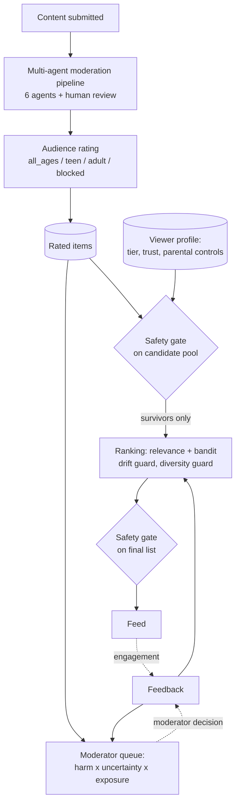

# Method: the system, stated precisely

Source files are under `recommendation/src/`. Full policy text: `recommendation/docs/02_safety_policy.md`.

## 1. Overview

The design principle: the two gate boxes are the same deterministic code, and nothing
between them can add an item. Learned components only reorder or drop gate survivors.

## 2. Host pipeline (existing system, not a contribution)

A LangGraph state machine with agents for content analysis, toxicity detection, policy
violation, a ReAct-style synthesis step, user reputation and action enforcement, plus a
human-in-the-loop checkpoint. Each agent appends a verdict and a confidence. Final statuses
include approved, flagged, under review, pending human review, warned, removed.

## 3. Audience rating

Ratings are ordered `all_ages < teen < adult < blocked`. Derivation starts at `all_ages`
and applies rules that can only raise the rating (a monotone, join-style combination).

| Signal | Effect |
|---|---|
| Status removed, author sanctioned, or content removed | blocked |
| Status not exactly "approved" | at least adult |
| Action present and not "approved" | at least adult |
| High-risk category without a human moderator's approval | blocked |
| High-risk category with a human approval | at least adult |
| Toxicity >= 0.75 / >= 0.35 / >= 0.10 | blocked / adult / teen |
| Toxicity missing or not a number in [0, 1] | at least adult |
| Policy violation other than spam or copyright | at least adult |
| Spam or copyright violation | at least teen |
| Any policy flag | at least adult |
| Severity medium or higher, or unknown | at least adult; "low" gives teen |
| Sensitive, explicit, hate-speech or harassment flag not exactly False | at least adult |
| Media risk above "low" | at least adult |
| Any judging agent did not allow (and no final human approval) | at least adult |
| Topic not on the teen list, or no topic | at least adult |
| Topic on the teen list but not the child list | at least teen |

**Fail-closed property.** For every input field, a missing, null, wrongly typed or
unrecognised value yields a rating at least as strict as any valid value. This is tested
by deleting and corrupting each field in turn.

**Agent agreement.** Disagreement = 1 - (size of the largest verdict group / number of
judging agents). Confidence = the lowest confidence a judging agent reported. Bookkeeping
approvals and the synthesis step's score are excluded. A final human approval sets
disagreement to 0.

## 4. Safety gate

For viewer tier `child < teen < adult` and an item, checks run in order; the first failure
rejects with a reason code.

| # | Check | Applies to |
|---|---|---|
| 1 | Rated blocked, or removed/banned status | everyone |
| 2 | Status not approved or warned | everyone |
| 3 | No rating | minors and self-declared adults |
| 4 | Parental blocked topic (word-stem match) or parental rating cap | profiles with controls |
| 5 | High-risk category label | child, teen |
| 6 | Rating rank above tier rank | everyone |
| 7 | Topic off the tier's allow-list, disallowed violation, or toxicity over the tier limit | child, teen |
| 8 | Sensitive teen topic without parental allowance | child, teen |
| 9 | Borderline item | child; teen under strict controls |
| 10 | Status not exactly approved, signals missing, or uncertainty too high | child, teen, self-declared adult |

Uncertainty margin (check 10): reject if

    disagreement >= T   or   confidence < 1 - T,     T = 0.45 x trust x strictness

with trust in {verified 1.0, parent-linked 0.85, self-declared 0.7} and strictness in
{low 1.0, medium 0.8, strict 0.6}. Lower trust in the declared age therefore narrows what
is served, and so does a stricter parental setting.

Properties worth stating in the paper:

- **Independence from personalization.** The gate reads tier, trust and parental controls
  only. Interests, learned weights, feed history and bandit state are not inputs.
- **Defence in depth.** Checks 5 and 7 repeat, inside the gate, conditions the rating
  already encodes, so a wrong or stale rating alone cannot expose a minor.
- **Double application.** The gate runs on the candidate pool and on the ranked output.
- **Input re-validation.** Items and profiles are re-validated on entry; anything that
  fails validation is rejected.

## 5. Personalization (on gate survivors only)

**Interest sourcing by tier.**

| | Child | Teen | Adult |
|---|---|---|---|
| Explicit interests | Curated child list | Teen list; sensitive topics need a parent | Free, except high-risk categories |
| Learned engagement | Re-weights existing topics in [0.1, 1.0]; never adds | Adds at most 3 topics | Adds at most 8 topics |
| Blend explicit : learned | explicit only | 0.6 : 0.4 | 0.5 : 0.5 |

**Score.** `score = 0.7 x relevance + 0.3 x bandit_sample`

- Relevance: cosine similarity between TF-IDF vectors of the item (category, topics, text)
  and the profile's weighted interest vector.
- Bandit: Thompson sampling with a Beta(alpha, beta) arm per (tier, topic). Rewards:
  click +0.5, long view +1, skip -0.5; positive reward adds to alpha, negative to beta.

**Drift guard.** (i) Hard cap on the share of borderline-risk items over the recent window
plus the feed being built: teen 15 %, adult 30 %, child 0. (ii) If the least-squares slope
of risk over the last 20 served items exceeds 0.01, items riskier than the recent mean are
multiplied by 0.5. Borderline-risk: toxicity >= 0.25.

**Diversity guard (adult).** ceil(0.2 x k) of k slots are reserved for items sharing no
topic with the profile's interests, when such items exist.

## 6. Moderator side

**Priority.** `priority = harm x uncertainty x exposure x m`

- harm: toxicity (0.5 if unknown); at least 0.5 with a non-trivial violation; 0.95 for a
  high-risk category
- uncertainty: max(disagreement, 1 - confidence), floor 0.05; 1.0 if signals are missing
- exposure: 1 + log10(1 + views)
- m: 0.5 + posterior mean of a Beta arm per category, updated by moderator decisions
  (+1 when the moderator overrode the agents, -0.5 when they agreed)

Sort key: high-risk items first, then priority descending, then oldest first. High-risk
ordering is a separate key, not a term in the score, so no learned value can outrank it.
High-risk items are visible to senior roles only.

**Precedents.** For a queued item, the k most similar resolved cases by TF-IDF cosine
similarity over category, topics and agent verdict, plus 0.3 for an equal category. The
suggested action is the human action with the largest similarity-weighted support.

## 7. Human override path

A moderator's decision outranks a later machine rating. Approval alone rates an item
adult at most. An item a moderator has both approved and tagged by hand is rated from
those tags, with the item's machine signals (toxicity, violations, high-risk labels,
allow-lists) still able to raise the rating.

## 8. Implementation facts

- Python 3.12, FastAPI, Pydantic 2, LangGraph; SQLite storage in a separate file.
- 14 source modules, about 3,200 lines; about 3,700 lines of tests.
- Feature flag off by default; with it off the host pipeline's output is unchanged.
- Six HTTP endpoints plus one for moderator tags, all using the host's authentication.
